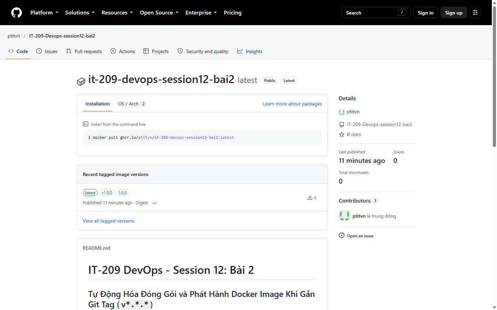
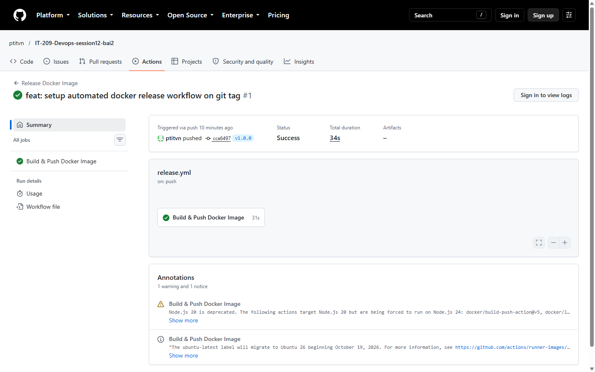
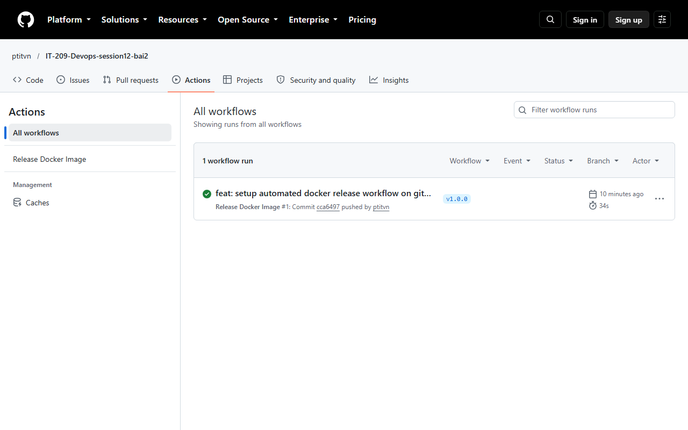
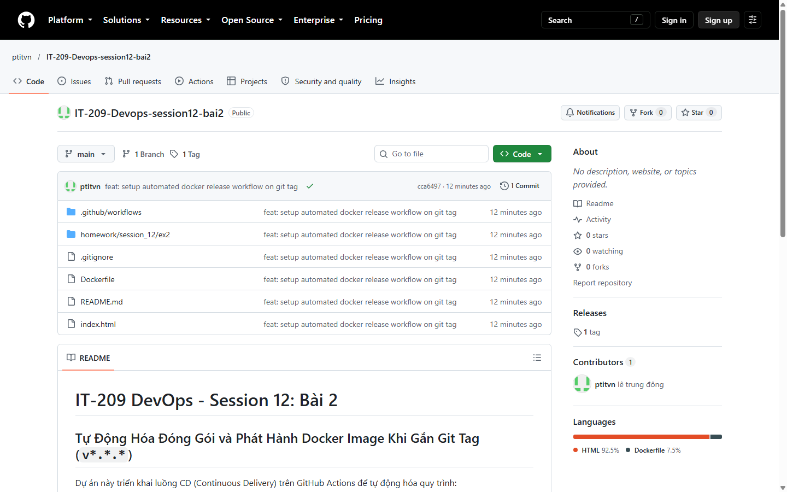

# BÁO CÁO BÀI TẬP - SESSION 12: BÀI 2

## Chủ đề: Tự động hóa đóng gói và phát hành Docker Image khi gắn Git Tag (v*.*.*)

---

## 1. Mục tiêu bài tập
- Cấu hình luồng CD (Continuous Delivery) tự động phát hành phiên bản Docker Image chính thức khi có sự kiện gán nhãn Release (Git Tag `v*.*.*`).
- Tạo thẻ Docker Tag tự động tương ứng với số phiên bản Git Tag bằng `docker/metadata-action@v5`.
- Đăng nhập và xuất bản (push) Docker Image lên GitHub Container Registry (`ghcr.io`) thông qua `docker/build-push-action@v5` và `docker/login-action@v3`.

---

## 2. Cấu hình kịch bản GitHub Actions Release Workflow

Tệp kịch bản được định nghĩa tại: `.github/workflows/release.yml` và lưu trữ nộp bài tại `homework/session_12/ex2/release.yml`.

```yaml
name: Release Docker Image

on:
  push:
    tags:
      - 'v*.*.*'

permissions:
  contents: read
  packages: write

jobs:
  release-image:
    name: Build & Push Docker Image
    runs-on: ubuntu-latest

    steps:
      - name: Checkout code
        uses: actions/checkout@v5

      - name: Set up Docker Buildx
        uses: docker/setup-buildx-action@v3

      - name: Log in to GitHub Container Registry
        uses: docker/login-action@v3
        with:
          registry: ghcr.io
          username: ${{ github.actor }}
          password: ${{ secrets.GITHUB_TOKEN }}

      - name: Extract Docker metadata
        id: meta
        uses: docker/metadata-action@v5
        with:
          images: ghcr.io/${{ github.repository }}
          tags: |
            type=semver,pattern={{version}}
            type=ref,event=tag

      - name: Build and push Docker image
        uses: docker/build-push-action@v5
        with:
          context: .
          push: true
          tags: ${{ steps.meta.outputs.tags }}
          labels: ${{ steps.meta.outputs.labels }}
```

---

## 3. Phân tích các thành phần kỹ thuật quan trọng

1. **Trigger `on.push.tags: ['v*.*.*']`:**
   - Kịch bản chỉ kích hoạt khi có sự kiện đẩy thẻ tag khớp với định dạng Semantic Versioning như `v1.0.0`, `v1.2.3`,... Giúp phân tách rõ ràng giữa việc đẩy commit code thông thường và phát hành phiên bản chính thức.
2. **Quyền truy cập `permissions: packages: write`:**
   - Cực kỳ quan trọng để cho phép biến môi trường bí mật `secrets.GITHUB_TOKEN` có quyền đẩy (push) gói Docker Image lên GitHub Container Registry (`ghcr.io`).
3. **Trích xuất tag với `docker/metadata-action@v5`:**
   - Đọc thông tin từ git ref/tag và tự động sinh danh sách Docker tag chuẩn (ví dụ tag Git `v1.0.0` sinh ra Docker tag `ghcr.io/...:v1.0.0` và `1.0.0`). Đồng thời tự động chuẩn hóa tên repository về chữ thường theo tiêu chuẩn Docker.
4. **Đóng gói và phát hành với `docker/build-push-action@v5`:**
   - Sử dụng Docker Buildx để build image từ Dockerfile và push trực tiếp lên GHCR một cách an toàn và nhanh chóng.

---

## 4. Hướng dẫn kiểm tra và quy trình thực hiện

### Bước 1: Gán Git Tag và đẩy lên GitHub
Thực thi lệnh trong terminal tại thư mục dự án:
```bash
git tag v1.0.0
git push origin v1.0.0
```

### Bước 2: Kiểm tra tab Actions
1. Truy cập repository trên GitHub: `https://github.com/ptitvn/IT-209-Devops-session12-bai2`
2. Chọn tab **Actions**.
3. Workflow **Release Docker Image** kích hoạt với commit tag `v1.0.0` và trạng thái chuyển sang màu xanh lá (**Success**).

### Bước 3: Kiểm tra GitHub Packages
1. Tại trang chính của repository (tab **Code**), nhìn sang cột bên phải mục **Packages** (hoặc truy cập trực tiếp mục Packages của tài khoản/tổ chức).
2. Nhấn vào package vừa được đẩy lên, kiểm tra thông tin package với tag `v1.0.0`.

---

## 5. Kết quả thực thi thực tế (Ảnh chụp màn hình minh chứng)

### 5.1. Minh chứng gói Docker Image phát hành trên GitHub Packages
Gói Docker Image `it-209-devops-session12-bai2` với thẻ phiên bản `v1.0.0` và lệnh kéo image tương ứng `docker pull ghcr.io/ptitvn/it-209-devops-session12-bai2:v1.0.0`:



### 5.2. Minh chứng Workflow `Release Docker Image` thực thi thành công
Toàn bộ các bước đóng gói và đẩy image lên GitHub Container Registry đều hoàn thành với trạng thái Success:



### 5.3. Tổng quan danh sách Workflow Runs trên tab Actions
Workflow `Release Docker Image` kích hoạt tương ứng với sự kiện push tag `v1.0.0`:



### 5.4. Giao diện Repository hiển thị liên kết Packages
Mục Packages bên cột phải của Repository đã liên kết thành công với Docker Image:



